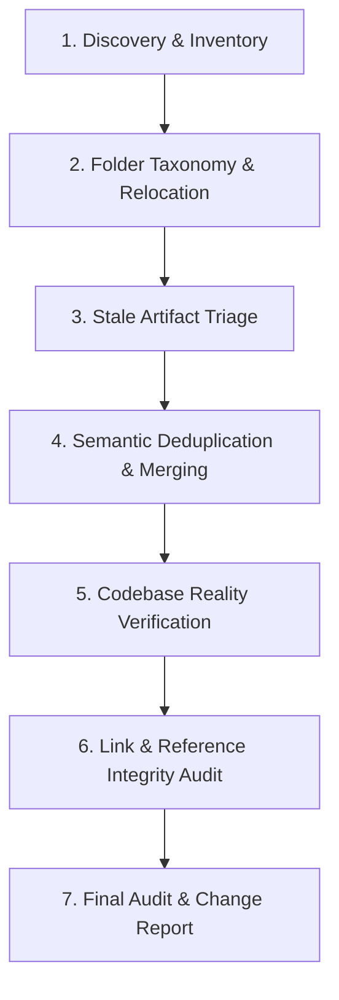

# Documentation & Workspace Cleaner Pro 🧹📚

A rigorous, professional skill designed to transform messy, cluttered project directories and fragmented documentation into clean, well-structured, single-source-of-truth knowledge bases.

---

## 🎯 Core Principles

1. **Root Folder Hygiene**: The repository root must remain pristine. Only universal entry-point files (`README.md`, `LICENSE`, `CONTRIBUTING.md`, `SECURITY.md`, configuration files like `pyproject.toml`, `package.json`, `.gitignore`) belong at root. All domain documentation belongs under `docs/`, implementation plans under `plans/`, and operational scripts under `scripts/`.
2. **Single Source of Truth (SSOT)**: A feature, workflow, configuration parameter, or architectural decision should be authoritatively documented in exactly one place. Other documents must reference it rather than re-explaining or copy-pasting it.
3. **Technical Reality Alignment**: Documentation must describe the codebase as it actually exists, not as an aspirational fantasy. Scripts, environment variables, CLI flags, default ports, and version numbers documented in Markdown must match actual code and configuration.
4. **Zero Accidental Data Loss**: Never delete or truncate files blindly. Always inventory, map overlaps, verify that essential knowledge is consolidated into a target document, and produce an auditable change log before removing redundant files.
5. **Bidirectional Link Integrity**: Every relative file link (`[text](docs/foo.md#section)`) must resolve to an existing file and anchor.

---

## 🔄 The 7-Stage Execution Lifecycle

When instructed to clean up documentation or workspace folders, follow this sequence without skipping phases:



---

### Stage 1: Workspace Discovery & Inventory Matrix

Before modifying any file, perform a complete scan of the workspace to build an inventory of all Markdown (`.md`), text (`.txt`), scripts (`.py`, `.sh`, `.ps1`, `.js`, `.mjs`), and temporary artifacts.

1. **Identify Loose Files**: List all files sitting in the root directory and evaluate whether they belong at root.
2. **Catalog Documentation Files**: Scan `docs/`, `plans/`, and subpackages to map the documentation footprint.
3. **Build the Inventory Matrix**: Record each document's path, size, primary topic, target audience, and referenced files in a temporary working matrix (or scratch note):

| File Path | Current Location | Primary Subject | Intended Folder | Action Needed |
|:---|:---:|:---|:---:|:---:|
| `INSTALL.txt` | Root | Installation steps | `docs/INSTALL.md` | Move & convert to MD |
| `setup_old.py` | Root | Outdated install helper | `scripts/` or delete | Review for deprecation |
| `docs/API_v1.md` | `docs/` | Deprecated v1 endpoints | `docs/archive/` | Archive or merge |

---

### Stage 2: Folder Taxonomy & File Placement Rules

Enforce the standard repository layout. Relocate files according to their primary purpose:

| Content Type | Target Directory | Placement Rules |
|:---|:---|:---|
| **Root Essentials** | `/` (Root) | Only universal entrypoints: `README.md`, `LICENSE`, `CHANGELOG.md`, `SECURITY.md`, `.gitignore`, package manifests (`package.json`, `pyproject.toml`). |
| **Living Documentation** | `docs/` | User manuals, architectural overviews, API guides, deployment guides, security policies, FAQs. |
| **Active Plans & Specs** | `plans/` | Design documents, implementation RFCs, sprint roadmaps, active milestone plans. |
| **Automation & Tooling** | `scripts/` | Build scripts, deployment automation, test runners, database migration utilities, CI helpers. |
| **Historical & Deprecated** | `docs/archive/` | Retired specifications, legacy roadmaps, superseded proposals (never mix with living docs). |
| **Developer Secrets & Local**| `local-secrets/` | Local keys, dev certificates, private `.env` files (must be strictly gitignored). |

*Note: Use `git mv` or equivalent file moves to preserve version control history whenever possible.*

---

### Stage 3: Stale Artifact & Temporary File Triage

Identify and safely remove build debris, temporary logs, and transient files that clutter the repository:

1. **Target Candidate Classes**:
   - Backup files (`*.bak`, `*~`, `*.orig`, `*.swp`)
   - Stray test database files (`test.db`, `test_visual.db`) outside designated test directories
   - Orphaned logs (`*.log`, `install.log.old`, `npm-debug.log*`)
   - Stray screenshot dumps or trace folders that lack `.gitignore` coverage
   - Scratch scripts that served a one-off purpose and are no longer referenced
2. **Safety Verification**:
   - Check if any candidate file is referenced in `.gitignore`.
   - Verify that no running service, test suite, or developer depends on the file.
   - For user-created scratch files or ambiguous notes, present a candidate deletion list before purging.

---

### Stage 4: Semantic Deduplication & Content Consolidation

When multiple documents address the same subject, consolidate them into a definitive single source of truth.

#### 1. Group by Topic Cluster
Cluster files sharing identical or overlapping themes:
- *Cluster A: Installation & Setup* (`INSTALL.md`, `SETUP.md`, `GETTING_STARTED.md`, `README.md#install`)
- *Cluster B: Authentication & Security* (`AUTH.md`, `SECURITY.md`, `2FA_GUIDE.md`)
- *Cluster C: Deployment & Environments* (`DEPLOY.md`, `DOCKER.md`, `SERVER_SETUP.md`)

#### 2. Establish Canonical Home
For each cluster, determine the primary canonical document (e.g., `docs/INSTALL.md`).

#### 3. Merge Strategy (Extract, Synthesize, Prune)
- **Extract Unique Value**: Pull out non-duplicate details, troubleshooting tips, or platform-specific flags from secondary files.
- **Synthesize Clearly**: Rewrite the merged section to be concise, authoritative, and direct. Avoid repeating identical paragraphs across multiple files.
- **Replace with Links**: In secondary or high-level files (such as `README.md`), replace lengthy duplicate walkthroughs with a brief summary and a direct link to the canonical guide (e.g., `For complete step-by-step instructions, see [Installation Guide](docs/INSTALL.md)`).
- **Prune Redundant Files**: Once all valuable content from a redundant file (e.g., `INSTALL_OLD.txt`) is incorporated, remove the redundant file.

---

### Stage 5: Codebase Reality Verification (Ground-Truth Check)

Documentation often drifts from actual code. Perform a technical reality check on every document:

1. **Configuration & Environment Variables**: Check `.env.example` and config schemas (e.g., Pydantic `Settings`, `config.ts`). Verify that documented variable names, default values, and port numbers match reality.
2. **Commands & CLI Flags**: Verify that commands shown in guides actually execute in the target shell. Test flags (e.g., `--host`, `--port`, `--env-file`, `pytest` options).
3. **Dependency Versions**: Ensure prerequisites (Python version, Node version, Docker version, database minimums) match `package.json`, `pyproject.toml`, or `requirements.txt`.
4. **Contradiction Resolution**: If Document A says "PlannedEducation runs on port 8000" and Document B says "runs on port 5000", check the real application entrypoint (`main.py`, `vite.config.ts`), correct the outdated document, and align all mentions.

---

### Stage 6: Cross-Reference & Link Integrity Audit

Verify that all internal cross-references and markdown links are valid:

1. **Relative Path Resolution**:
   - Verify that `[Link Text](path/to/file.md)` correctly resolves from the source file's directory.
   - Check forward slashes vs. backslashes (always use forward slashes `/` for cross-platform markdown links).
2. **Heading Anchors**:
   - Verify that fragment identifiers (`#section-heading`) match GitHub / CommonMark anchor generation rules (lowercased, spaces replaced by hyphens, special characters removed).
3. **Dead Link Elimination**:
   - If a referenced file was moved or merged, update the link to point to the new canonical destination.
   - Never leave broken `404` links in documentation.

---

### Stage 7: Final Audit & Change Report

Conclude the cleanup by generating a clear, structured summary report for the user:

```markdown
### 🧹 Workspace & Documentation Cleanup Summary

1. **Relocated Files**:
   - Moved `<source>` -> `<destination>` (Reason: ...)

2. **Consolidated & Merged Documentation**:
   - Merged `<file-a>` and `<file-b>` into canonical `<canonical-file>`.
   - Replaced duplicate text in `<readme>` with deep link to canonical guide.

3. **Stale Files Purged**:
   - Removed `<file>` (Reason: dead temp log / unreferenced duplicate).

4. **Technical Corrections**:
   - Fixed outdated port/flag in `<doc>` to match codebase reality.

5. **Link Verification**:
   - Audited X internal markdown links (0 broken links remaining).
```

---

## 🛡️ Guardrails & Safety Rules

- **Do Not Discard Domain Lore**: If a document contains rationale, historical decisions, or specific bug workarounds, preserve the rationale in the canonical guide or an engineering decision record (`plans/` or `docs/architecture/`).
- **Do Not Touch Production Data**: Never delete database files (`*.db`, `*.sqlite`) or configuration secrets without explicit user confirmation.
- **Maintain Documentation Integrity**: Preserve existing docstrings, API comments, and licensing headers unless specifically updating them.
- **Atomic Commits**: Group structural cleanup moves into dedicated commits separate from feature code changes.