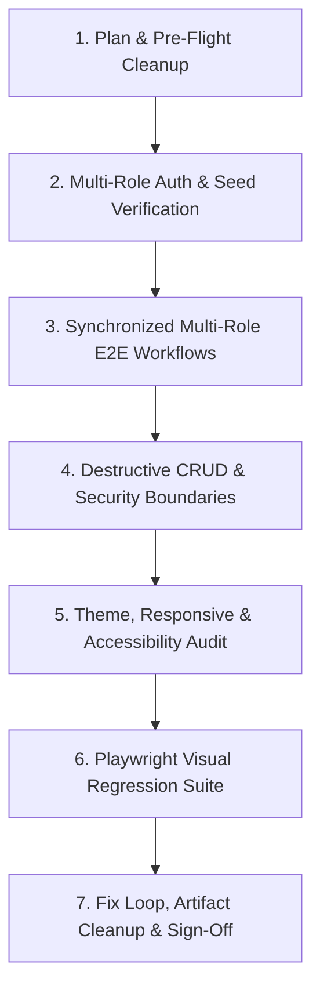

# Full-Platform E2E & Website Visual Tester Pro 🧪📸

This unified skill combines **Playwright Visual Regression Testing** (`website-visual-tester`) and **Full-Platform Multi-Role End-to-End QA** (`full-platform-qa-pro`) into a single, comprehensive reference. Use it for both targeted UI screenshot assertions and complete multi-role platform verification runs.

---

## 🎯 Core Testing Principles

1. **Never Get Locked Out (Authenticated Journey First)**:
   - Never get stuck testing only public login pages.
   - Check `local-secrets/` or test fixtures for existing test credentials, or seed/register dedicated test accounts for every role (**Admin**, **Teacher**, **Student**, **Parent**) before running functional and visual suites.
2. **Multi-Role Real-Time Synchronization**:
   - Verify that actions taken by one role immediately and accurately reflect in connected sessions of other roles (e.g., Teacher creates/starts an exam $\rightarrow$ Student sees and takes the exam with live heartbeats/hand-raise $\rightarrow$ Teacher grades submission $\rightarrow$ Student & Parent see updated results).
3. **Destructive & Edge-Case Coverage**:
   - Explicitly test destructive and administrative actions (creating temporary users, resetting passwords/2FA, revoking sessions, deleting test users/records) using disposable test accounts so seed/production data remains intact.
4. **Visual, Theme & Accessibility Perfection**:
   - Every view must be verified across all supported themes (`light`, `dark`, `high-contrast`) and viewports (`mobile`, `tablet`, `desktop`, `wide`).
   - Zero tolerance for overlapping elements, clipped text, broken contrast, oversized/undersized controls, or misaligned layouts.
5. **Empathetic, Human-Centered UX**:
   - Verify that all user-facing messages, error states, and empty states are kindly worded, clear, supportive, and free of raw engineering/debug jargon (no stack traces, `.env` references, or SHA hashes in UI).
6. **Self-Monitoring & Zero Orphaned Processes**:
   - Log progress continuously to `scratch/test_progress.md` to prevent infinite loops.
   - Terminate all background servers (`node`, `python`, `uvicorn`, `playwright`) and remove temporary test artifacts (`test-results/`, `playwright-report/`, temporary `.db` files) via `globalTeardown` and post-run scripts before claiming completion.

---

## 🔄 Part 1: The 7-Stage Full-Platform E2E Lifecycle



### Stage 1: Test Plan, Self-Monitoring & Pre-Flight Hygiene
1. **Initialize Progress Log**: Create or update `scratch/test_progress.md` before starting servers or browser runners. Record each test phase, server PID/port, discovered defect, and fix status.
2. **Pre-Flight Process Hygiene**: Kill any lingering orphaned processes from prior runs before starting test servers:
   ```powershell
   Get-Process -Name "node", "uvicorn" -ErrorAction SilentlyContinue | Stop-Process -Force
   ```
3. **Update Active Plan**: Update the active plan in `plans/` to mark the QA run `in progress`.

### Stage 2: Multi-Role Authentication & Account Provisioning
Verify authentication and session boundaries for every role:

| Role | Verification Scope |
|:---|:---|
| **Admin** | System statistics, user directory, role assignment, direct password reset, 2FA/Passkey reset, audit logs. |
| **Teacher** | Class creation, student roster management, module/package import & export, exam creation, live proctoring/monitoring, grading & rubric feedback. |
| **Student** | Joining classes, viewing assigned exams, Safe Exam Browser (SEB) / lockdown entry, dynamic question rendering, digital hand-raise, submission idempotency. |
| **Parent** | Read-only portal access, linked student progress, score breakdowns, teacher feedback visibility. |

### Stage 3: Synchronized Multi-Role E2E Workflows
Execute a multi-context Playwright test simulating real classroom concurrency:
1. **Teacher Context**: Log in as Teacher, create a multi-question assessment (MCQ, dynamic formula randomization, essay rubric), and publish/open it for the class.
2. **Student Context (Parallel Browser Context)**: Log in as Student, verify zero answer leakage in network payloads, start the exam session, send live heartbeats, trigger a Digital Hand Raise, and submit answers.
3. **Real-Time Sync Verification**: Confirm the Teacher dashboard receives the Student's live status, hand-raise alert, and final submission in real time.
4. **Grading & Parent Context**: Grade the submission as Teacher, then log in as Parent and Student to verify that scores and feedback render accurately.

### Stage 4: Destructive CRUD & Security Boundary Testing
Test destructive operations safely against disposable entities:
1. **Disposable User Lifecycle**: Create a temporary user (`temp_delete_me@test.local`), modify their role/settings, reset their password and 2FA from the Admin Panel, verify login with the temporary password, and **delete** the user. Confirm the deleted user receives `401 Unauthorized` thereafter.
2. **Negative Authorization Checks**:
   - Verify that a Student token calling `/admin/*` or `/teacher/*` receives `403 Forbidden`.
   - Verify that duplicate exam submissions return `409 Conflict`.

### Stage 5: Theme, Responsive & Accessibility Geometry Audit
Cycle through every registered theme (`light`, `dark`, `high-contrast`) and viewport size on all major pages, asserting via automated DOM checks:
- **Zero Horizontal Overflow**: `document.documentElement.scrollWidth <= window.innerWidth`
- **Readable Contrast & Font Sizing**: Computed font size $\ge 12\text{px}$ for body/labels; text color contrasts against background.
- **Proper Control Sizing**: Interactive buttons and inputs have bounding boxes $\ge 32\times 32\text{px}$ and do not overlap sibling elements.
- **Friendly Microcopy**: Error banners and status cards render inline near the relevant submit buttons with constructive, empathetic wording.

---

## 📸 Part 2: Playwright Visual Regression Testing Reference

### Core Concepts & Snapshot Management
Playwright Test includes `toHaveScreenshot()` for pixel-perfect visual comparisons:
- **Baseline screenshots**: Generated on first run, stored in `{test-file}-snapshots/` directory.
- **Platform-specific**: Separate baselines per browser/OS (`chromium-win32`, `chromium-linux`, `webkit-darwin`, etc.).
- **Update workflow**: Use `--update-snapshots` flag to refresh baselines when UI changes intentionally.

```typescript
import { test, expect } from '@playwright/test';

test('homepage visual regression', async ({ page }) => {
  await page.goto('https://example.com');
  await expect(page).toHaveScreenshot('homepage.png');
});
```

### Key CLI Commands

#### Playwright CLI (Interactive Inspection for Agents)
```bash
# Install globally
npm install -g @playwright/cli@latest

# Install visual testing skills
playwright-cli install --skills

# Visual testing workflow
playwright-cli open https://example.com --headed
playwright-cli snapshot --filename=baseline.yaml
playwright-cli screenshot --filename=current.png
```

#### Playwright Test Commands
```bash
# Run visual tests on Chromium
npx playwright test --project=chromium

# Update snapshots when UI changes intentionally
npx playwright test --update-snapshots

# Run with specific browser
npx playwright test --project=firefox

# Debug specific visual test
npx playwright test --debug visual/homepage.spec.ts

# Show HTML report or trace viewer
npx playwright show-report
npx playwright show-trace trace.zip
```

---

### Complete `playwright.config.ts` with Automatic Cleanup (`globalTeardown`)

Configure Playwright with multi-viewport projects, deterministic screenshot thresholds, and automatic post-run artifact cleanup:

```typescript
import { defineConfig, devices } from '@playwright/test';
import { existsSync, rmSync } from 'fs';
import { join } from 'path';

const TEST_ARTIFACTS_DIRS = [
  'test-results',
  'playwright-report',
  'artifacts/visual-test-screenshots',
];

function cleanupTestArtifacts() {
  for (const dir of TEST_ARTIFACTS_DIRS) {
    const fullPath = join(process.cwd(), dir);
    if (existsSync(fullPath)) {
      rmSync(fullPath, { recursive: true, force: true });
      console.log(`Cleaned up: ${dir}`);
    }
  }
}

export default defineConfig({
  testDir: './tests/visual',
  snapshotDir: './tests/visual/snapshots',
  projects: [
    { name: 'chromium', use: { ...devices['Desktop Chrome'] } },
    { name: 'firefox', use: { ...devices['Desktop Firefox'] } },
    { name: 'webkit', use: { ...devices['Desktop Safari'] } },
    { name: 'mobile-chrome', use: { ...devices['Pixel 5'] } },
    { name: 'mobile-safari', use: { ...devices['iPhone 12'] } },
  ],
  expect: {
    toHaveScreenshot: {
      maxDiffPixels: 100,
      threshold: 0.2,
      animations: 'disabled',
    },
  },
  globalTeardown: async () => {
    cleanupTestArtifacts();
  },
});
```

---

### Advanced Visual Testing Patterns

#### 1. Custom Snapshot Options & Masking Volatile Elements
```typescript
// Per-test customization with CSS injection to hide volatile UI
await expect(page).toHaveScreenshot('custom-name.png', {
  maxDiffPixels: 50,
  threshold: 0.1,
  stylePath: './tests/visual/screenshot.css',
  animations: 'disabled',
});

// Mask dynamic regions (timestamps, live timers, avatars)
await expect(page).toHaveScreenshot('dashboard.png', {
  mask: [
    page.locator('.timestamp'),
    page.locator('.user-avatar'),
    page.locator('[data-testid="live-timer"]'),
  ],
});
```

#### 2. Component-Level State Testing (Default, Hover, Focus, Disabled)
```typescript
test('button component states', async ({ page }) => {
  await page.goto('/storybook/iframe.html?id=button--primary');

  // Default state
  await expect(page.locator('button')).toHaveScreenshot('button-default.png');

  // Hover state
  await page.locator('button').hover();
  await expect(page.locator('button')).toHaveScreenshot('button-hover.png');

  // Disabled state
  await expect(page.locator('button[disabled]')).toHaveScreenshot('button-disabled.png');
});
```

#### 3. Responsive Multi-Viewport & Multi-Theme Matrix
```typescript
const viewports = [
  { name: 'mobile', width: 375, height: 667 },
  { name: 'tablet', width: 768, height: 1024 },
  { name: 'desktop', width: 1280, height: 720 },
  { name: 'wide', width: 1920, height: 1080 },
];

const themes = ['light', 'dark', 'high-contrast'];

for (const theme of themes) {
  for (const vp of viewports) {
    test(`dashboard in ${theme} mode at ${vp.name}`, async ({ page }) => {
      await page.setViewportSize({ width: vp.width, height: vp.height });
      await page.goto('/');
      await page.evaluate((t) => document.documentElement.setAttribute('data-theme', t), theme);
      await expect(page).toHaveScreenshot(`dashboard-${theme}-${vp.name}.png`, {
        fullPage: true,
        animations: 'disabled',
      });
    });
  }
}
```

#### 4. Full Page vs. Element & Clipped Screenshots
```typescript
// Full scrollable page
await expect(page).toHaveScreenshot('full-page.png', { fullPage: true });

// Specific container element
await expect(page.locator('#main-content')).toHaveScreenshot('main-content.png');

// Clipped region
await expect(page.locator('.card')).toHaveScreenshot('card.png', {
  clip: { x: 0, y: 0, width: 400, height: 300 },
});
```

---

### CI/CD Integration (GitHub Actions)

```yaml
# .github/workflows/visual-tests.yml
name: Visual Regression Tests

on: [push, pull_request]

jobs:
  visual-tests:
    runs-on: ubuntu-latest
    steps:
      - uses: actions/checkout@v4
      - uses: actions/setup-node@v4
        with:
          node-version: '22'
      - run: npm ci
      - run: npx playwright install --with-deps chromium
      - name: Run visual tests
        run: npx playwright test --project=chromium
      - name: Upload diff artifacts on failure
        uses: actions/upload-artifact@v4
        if: failure()
        with:
          name: visual-test-screenshots
          path: test-results/
      - name: Cleanup artifacts
        if: always()
        run: rm -rf test-results playwright-report
```

---

### Troubleshooting & Best Practices

| Issue | Solution |
|:---|:---|
| **Font rendering differences** | Use the same OS/container environment for baseline generation and test execution; wait for `document.fonts.ready`. |
| **Anti-aliasing variations** | Configure `threshold: 0.2` and `maxDiffPixels: 100` to tolerate minor sub-pixel GPU rendering differences. |
| **Dynamic / volatile content** | Use `mask: [page.locator(...)]` or `stylePath` CSS rules (`visibility: hidden`) on timestamps, timers, and random IDs. |
| **Timing & layout shifts** | Wait for network idle (`waitUntil: 'networkidle'`), disable CSS animations (`animations: 'disabled'`), and stabilize web fonts. |
| **Orphaned background processes** | Always terminate `node`, `uvicorn`, `python`, and `playwright` processes after the suite finishes. |

---

## 🔗 Related Skills in This Library
- [`webdesign-and-modern-web/modern-web-guidance/SKILL.md`](./webdesign-and-modern-web/modern-web-guidance/SKILL.md) — Native CSS/HTML layout, dark mode, and typography patterns.
- [`chrome-devtools/a11y-debugging/SKILL.md`](./chrome-devtools/a11y-debugging/SKILL.md) — Accessibility tree and ARIA debugging.
- [`chrome-devtools/debug-optimize-lcp/SKILL.md`](./chrome-devtools/debug-optimize-lcp/SKILL.md) — Core Web Vitals and LCP performance optimization.
- [`code-review.md`](./code-review.md) — 10-Section code, security, and modularity review.