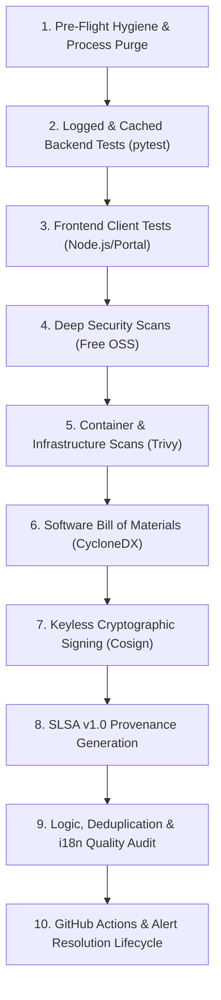

# Universal All-Tester & CI/CD Security Pro 🧪🛡️

Master operational standard for comprehensive local and remote verification across PlannedEducation. This skill guides human developers and autonomous AI agents through the complete, end-to-end verification lifecycle: from source-aware incremental Python tests and frontend bundle builds, through deep open-source security scans and container audits, to SLSA v1.0 provenance and GitHub Actions pipeline enforcement.

---

## 🎯 Core Principles & Guardrails

1. **100% Free / Open-Source Tooling Only (Strict Compliance)**:
   - All tests, security scanners, linters, SBOM generators, and signing tools must use free and open-source software (OSS).
   - **Explicitly Forbidden**: Paid security tools (Snyk, SonarQube Cloud paid tiers, Datadog, Veracode) or GitHub features requiring paid tiers on private repos (CodeQL, Secret Protection, Copilot Autofix). Reference: [`docs/GITHUB_FREE_TIER.md`](file:///c:/dev/PlannedEducation/docs/GITHUB_FREE_TIER.md) and [`AGENTS.md`](file:///c:/dev/PlannedEducation/AGENTS.md#L30-L75).

2. **Source-Aware Test Caching (Zero Pointless Retests)**:
   - Python tests must **always** be invoked through the source-aware cache helper:
     ```powershell
     C:/.venv/Scripts/python.exe scripts/testing/update_test_cache.py --skip-if-clean --suite-name "<suite-name>" -- C:/.venv/Scripts/python.exe -m pytest <test-path> -v
     ```
   - Maintained in `artifacts/test_cache/source_test_results.json`, comparing SHA-256 fingerprints across `src/`, `tests/`, `scripts/`, `alembic/`, and configuration files (`requirements.txt`, `pytest.ini`, `pyproject.toml`). Unmodified suites are skipped instantly (0 ms waste).

3. **Continuous Monitoring & Active Progress Logging**:
   - Long-running commands must produce continuous, active feedback (step counters, file names, percentages like `[11%]`, `[22%]`).
   - If a background process produces no output for more than 10 seconds, it must be flagged and investigated.
   - Logs are continuously streamed to stdout and stored at DEBUG level in `artifacts/test_run.log`.

4. **Zero Orphaned Process Hygiene (MANDATORY)**:
   - Before starting any test suite, and immediately after completing a run (pass or fail), kill all orphaned background processes (`node`, `python`, `uvicorn`, `playwright`).
   - Background processes running unattended for $> 30$ minutes must be terminated.

5. **Dual-Layer Verification (Local Pre-Flight + GitHub Actions CI)**:
   - Every verification must succeed locally before pushing to remote branches (`dev`, `main`).
   - After pushing, agents must verify that all remote GitHub Actions workflow runs (`Security Checks`, `CI/CD Pipeline`) finish with 100% green status and **0 open alerts** (Dependabot, Secret Scanning, Code Scanning).

---

## 🔄 The 10-Stage Universal Verification Architecture



---

### Stage 1: Pre-Flight Hygiene & Environment Preparation

Before executing tests, clear stale background processes, locks, and temporary test databases:

```powershell
# 1. Terminate orphaned processes
Get-Process -Name "node", "uvicorn" -ErrorAction SilentlyContinue | Stop-Process -Force
Get-Process -Name "python" -ErrorAction SilentlyContinue | Where-Object {$_.Id -ne $PID} | Stop-Process -Force

# 2. Remove stale test databases and pytest caches
Remove-Item -Path "test.db", "test_plannededucation.db", "test_visual.db" -ErrorAction SilentlyContinue -Force
Remove-Item -Path "tests/__pycache__/*.pyc" -ErrorAction SilentlyContinue -Force

# 3. Verify clean Git status
git status --short --branch
```

---

### Stage 2: Python Backend Verification (Logged, Typed & Cached)

Execute backend quality and security assertions using the virtual environment (`C:/.venv/Scripts/python.exe`):

#### 2.1 Code Formatting & Linting (Ruff)
Fast AST-based linting enforcing PEP 8, whitespace rules, import sorting, and syntax hygiene:
```powershell
# Check for lint issues:
C:/.venv/Scripts/python.exe -m ruff check src/ tests/ scripts/

# Automatically fix safe and whitespace issues:
C:/.venv/Scripts/python.exe -m ruff check src/ tests/ scripts/ --fix --unsafe-fixes
```

#### 2.2 Static Type Checking (Mypy)
Verify type safety across FastAPI route handlers, Pydantic v2 models, and SQLAlchemy schemas:
```powershell
C:/.venv/Scripts/python.exe -m mypy src/plannededucation
```

#### 2.3 AST Security Scanning (Bandit)
Identify common security vulnerabilities (e.g. hardcoded secrets, unsafe deserialization, SQL injection patterns):
```powershell
C:/.venv/Scripts/python.exe -m bandit -r src/plannededucation -ll -ii
```

#### 2.4 Dependency Vulnerability Audit (pip-audit)
Scan all installed Python packages and `requirements.txt` against the PyPA Advisory Database:
```powershell
C:/.venv/Scripts/python.exe -m pip_audit -r requirements.txt
```

#### 2.5 Logged, Incremental Pytest Suites (with Test Cache Tracking)
Execute test suites through the cache helper to avoid redundant re-runs:
```powershell
# Full backend suite:
C:/.venv/Scripts/python.exe scripts/testing/update_test_cache.py --skip-if-clean --suite-name "backend-all" -- C:/.venv/Scripts/python.exe -m pytest tests/ -v --cov=src/plannededucation --cov-report=term-missing

# Focused domain suites:
# 1. Authentication & Security:
C:/.venv/Scripts/python.exe scripts/testing/update_test_cache.py --skip-if-clean --suite-name "backend-auth" -- C:/.venv/Scripts/python.exe -m pytest tests/test_auth.py tests/test_auth_flows.py -v

# 2. Exams & SEB Lockdown:
C:/.venv/Scripts/python.exe scripts/testing/update_test_cache.py --skip-if-clean --suite-name "backend-exams" -- C:/.venv/Scripts/python.exe -m pytest tests/test_routes_exam.py tests/test_exams.py tests/test_ai_exam_creation_api.py -v

# 3. Proctoring & GDPR Consent:
C:/.venv/Scripts/python.exe scripts/testing/update_test_cache.py --skip-if-clean --suite-name "backend-proctoring" -- C:/.venv/Scripts/python.exe -m pytest tests/test_routes_proctoring.py -v

# 4. International Curriculum & Modules:
C:/.venv/Scripts/python.exe scripts/testing/update_test_cache.py --skip-if-clean --suite-name "curriculum-all" -- C:/.venv/Scripts/python.exe -m pytest tests/test_hungary_curriculum_modules.py tests/test_germany_curriculum_modules.py tests/test_mit_curriculum_modules.py -v
```

> [!TIP]
> **Database Isolation in Tests**: Always use `sqlite:///:memory:` or mock sessions for new unit test suites to eliminate file lock contention on Windows and Linux runners.

---

### Stage 3: Frontend Client Verification (Node.js/Portal)

Execute frontend quality, security, and compilation checks inside `web/apps/portal`:

```powershell
cd web/apps/portal

# 1. Code Linting (ESLint)
npm run lint

# 2. Security Linting (Oxlint Security Rules)
npx oxlint --deny-warnings --security src/

# 3. Strict TypeScript Compilation (Zero Type Errors)
npm run build:prepare
npx tsc -b

# 4. Production Bundle Build (Vite)
npm run build

# 5. Dependency Vulnerability Audit (npm audit)
npm audit --audit-level=high --omit=dev

# 6. License Compliance Check (Permissive OSS Licenses Only)
npx license-checker --summary --onlyAllow "MIT;Apache-2.0;BSD-2-Clause;BSD-3-Clause;ISC;0BSD;Unlicense;CC0-1.0"

cd ../../..
```

---

### Stage 4: Deep Security Scans (Free OSS)

#### 4.1 Upstream Gitleaks OSS CLI Scanner
Verify that no passwords, API tokens, JWT secrets, private keys, or credentials exist in git history or working tree:
```powershell
# Run using the upstream OSS binary with project baseline:
gitleaks detect --source=. --config=.gitleaks.toml --verbose --baseline-path=.gitleaks-baseline.json
```
*Never use the commercial `gitleaks/gitleaks-action` wrapper on private repos.*

#### 4.2 Student Privacy & Anonymizer Verification (FERPA / GDPR)
Verify that student PII is stripped via Microsoft Presidio before any AI evaluation:
```powershell
C:/.venv/Scripts/python.exe scripts/testing/update_test_cache.py --skip-if-clean --suite-name "anonymizer-privacy" -- C:/.venv/Scripts/python.exe -m pytest tests/test_routes_anonymizer.py -v
```

---

### Stage 5: Container & Infrastructure Scans (Trivy Free OSS)

Scan container configuration files for misconfigurations, root user execution, and vulnerable packages:
```powershell
# 1. Scan Dockerfiles for security misconfigurations:
trivy config Dockerfile.backend
trivy config web/apps/portal/Dockerfile

# 2. Verify:
# - Non-root USER instruction specified
# - Minimal Alpine or distroless base images
# - No embedded secrets or tokens
```

---

### Stage 6: Software Bill of Materials (SBOM - CycloneDX Free OSS)

Generate machine-readable Software Bill of Materials in CycloneDX v1.5 JSON standard for both backend and frontend dependencies:

```powershell
# 1. Create output directory:
New-Item -ItemType Directory -Force -Path "artifacts/sbom" | Out-Null

# 2. Python Backend SBOM:
C:/.venv/Scripts/python.exe -m cyclonedx_py requirements requirements.txt -o artifacts/sbom/backend-cyclonedx.json

# 3. Node.js Frontend SBOM:
cd web/apps/portal
npx @cyclonedx/cyclonedx-npm --output-file ../../../artifacts/sbom/frontend-cyclonedx.json --omit dev
cd ../../..

# 4. Verify SBOM validity:
Test-Path artifacts/sbom/backend-cyclonedx.json
Test-Path artifacts/sbom/frontend-cyclonedx.json
```

---

### Stage 7: Keyless Cryptographic Signing (Cosign Free OSS)

In CI environments (GitHub Actions), sign generated SBOMs and build artifacts using keyless Sigstore / Cosign:

```bash
# GitHub Actions runner with id-token: write:
cosign sign-blob \
  --yes \
  --bundle artifacts/sbom/backend-cyclonedx.json.sig \
  artifacts/sbom/backend-cyclonedx.json

# Verification:
cosign verify-blob \
  --certificate-identity-regexp "https://github.com/ezixen/PlannedEducation/" \
  --certificate-oidc-issuer "https://token.actions.githubusercontent.com" \
  --bundle artifacts/sbom/backend-cyclonedx.json.sig \
  artifacts/sbom/backend-cyclonedx.json
```

---

### Stage 8: SLSA v1.0 Provenance Generation

Generate supply-chain attestation conforming to SLSA v1.0 Level 2/3 specifications:
```bash
# Capture build provenance payload:
cat <<EOF > artifacts/provenance.json
{
  "_type": "https://in-toto.io/Statement/v1",
  "subject": [
    {
      "name": "PlannedEducation-Release",
      "digest": {
        "sha256": "$(git rev-parse HEAD)"
      }
    }
  ],
  "predicateType": "https://slsa.dev/provenance/v1",
  "predicate": {
    "buildDefinition": {
      "buildType": "https://github.com/ezixen/PlannedEducation/.github/workflows/ci.yml",
      "externalParameters": {
        "repository": "https://github.com/ezixen/PlannedEducation",
        "ref": "$(git rev-parse --abbrev-ref HEAD)"
      }
    },
    "runDetails": {
      "builder": {
        "id": "https://github.com/actions/runner"
      }
    }
  }
}
EOF
```

---

### Stage 9: Logic, Deduplication & i18n Quality Audit

#### 9.1 Modularity & File Size Guidelines
Enforce the project sweet spot of $\le 400$ lines for implementation files (`.py`, `.ts`, `.tsx`), splitting logically at clear domain seams (UI panel, hook, service module) rather than arbitrary thresholds.

#### 9.2 Zero Hardcoded UI Strings (i18n Mandatory Check)
Verify that all user-facing text uses `t("domain.key")` from `I18nContext`:
```powershell
# Check for missing translation keys across all 37 languages:
C:/.venv/Scripts/python.exe scripts/i18n/check_missing_keys.py
```

#### 9.3 Code Deduplication & Redundancy Scan
Verify that logic is not copy-pasted across routes:
- Common database lookups go in `_get_exam_or_404`, `_get_user_or_404`.
- Auth checks go in centralized dependencies (`get_current_user`, `require_admin`).
- SEB verification centralized in `seb_security.py`.

---

### Stage 10: Remote GitHub Actions & Alert Resolution Lifecycle

Every push to `dev` or `main` triggers automated remote verification. Follow this strict resolution protocol:

```powershell
# 1. Push changes to branch:
git push origin <branch>

# 2. Watch Security Checks workflow:
gh run list --branch <branch> --limit 3
gh run watch <security-run-id> --exit-status

# 3. Watch CI/CD Pipeline workflow:
gh run watch <cicd-run-id> --exit-status

# 4. If any job fails, inspect failed logs:
gh run view <run-id> --log-failed

# 5. Check GitHub Alerts (must be 0 open before sign-off):
# Dependabot:
gh api repos/ezixen/PlannedEducation/dependabot/alerts --jq '.[] | select(.state=="open")'

# Secret Scanning:
gh api repos/ezixen/PlannedEducation/secret-scanning/alerts --jq '.[] | select(.state=="open")'
```

---

## 📋 Comprehensive Verification Matrix

| Category | Local Command | CI Action Counterpart | Pass Criteria |
|:---|:---|:---|:---|
| **Python Lint** | `ruff check src/ tests/ scripts/` | `Run linting (ruff)` | 0 errors, clean output |
| **Python Types** | `mypy src/plannededucation` | `Run type checking (mypy)` | 0 type errors |
| **Python Security** | `bandit -r src/plannededucation -ll -ii` | `Run security scan (bandit)` | 0 High/Medium issues |
| **Python Deps** | `pip-audit -r requirements.txt` | `Run dependency audit (pip-audit)` | 0 known vulnerabilities |
| **Backend Pytest** | `update_test_cache.py --skip-if-clean ...` | `Run tests with coverage` | 100% pass, $\ge 80\%$ coverage |
| **Frontend Lint** | `npm run lint` | `Run linting` | 0 ESLint errors |
| **Frontend Security** | `npx oxlint --security` | `Run security linting (oxlint)` | 0 security rule violations |
| **Frontend Types** | `npx tsc -b` | `Type check` | 0 TypeScript errors |
| **Frontend Build** | `npm run build` | `Build` | Exit code 0, dist generated |
| **Frontend Deps** | `npm audit --audit-level=high` | `Run npm audit` | 0 high/critical CVEs |
| **Secret Scan** | `gitleaks detect --source=. ...` | `gitleaks (OSS CLI)` | 0 secrets detected |
| **Container Scan** | `trivy config .` | `Container Scans (Trivy)` | 0 critical misconfigurations |
| **SBOM** | `cyclonedx-py` + `cyclonedx-npm` | `Generate SBOM (CycloneDX)` | Valid JSON SBOM artifacts |
| **Provenance** | `cosign sign-blob` | `Sign Artifacts / SLSA` | Valid SLSA v1.0 attestation |
| **GitHub Alerts** | `gh api .../dependabot/alerts` | GitHub Security tab | **0 open alerts** |

---

## 🛠️ Automated All-In-One Local Tester Script

Run the entire local pipeline with a single command:

```powershell
# Run the complete test suite with cache tracking and progress reporting:
C:/.venv/Scripts/python.exe run_tests.py --summary
```

To clean up all processes and artifacts afterwards:
```powershell
# Terminate lingering background processes:
Get-Process -Name "node", "uvicorn" -ErrorAction SilentlyContinue | Stop-Process -Force
Get-Process -Name "python" -ErrorAction SilentlyContinue | Where-Object {$_.Id -ne $PID} | Stop-Process -Force
```
